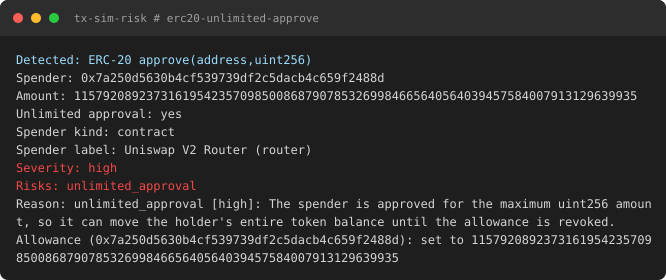
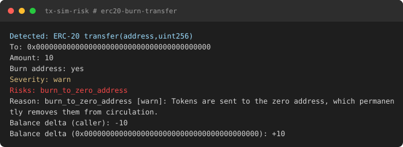
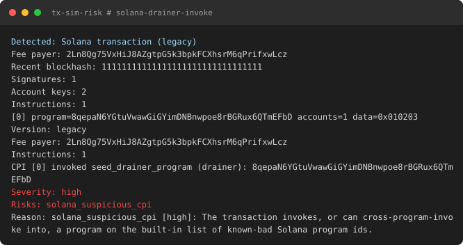

### tx-sim-risk — Explain what an Ethereum transaction will do, fast

[](https://github.com/SibghatUllah1997/tx-sim-risk/actions/workflows/ci.yml)
[](LICENSE)

One-liner: A tiny CLI and TypeScript library that decodes common ERC-20 calls and Solana transaction skeletons, and surfaces simple risk hints (like unlimited approvals) from raw calldata or full raw transactions.

Status: **v0.2.0**. See `docs/RELEASE-NOTES.md` for the tagged release notes.

Why it matters:
- Wallets often show hex data. It’s easy to miss risky approvals or burns.
- Quick, deterministic decoding helps reviewers and infra build guardrails before signing.

Features:
- Decode ERC-20 approve, transfer, increaseAllowance, decreaseAllowance
- Decode EIP-2612 and DAI-style `permit` signatures and flag unlimited permits (`unlimited_permit`)
- Decode Uniswap Permit2 `approve` / `permit` / `permitTransferFrom`, and flag unlimited or never-expiring grants (`permit2_no_expiry`)
- Split router `multicall` and Multicall3 `aggregate*` batches, run every inner call through the same rules, and flag grants hidden inside a batch (`multicall_batched_grant`)
- Parse ERC-4337 `handleOps` UserOperations, unwrap account `execute`, and flag a paymaster or a callData approval
- Decode Gnosis Safe `execTransaction` / `execTransactionFromModule`, analyze the inner call, and flag DelegateCall, hidden grants, and unsigned owner-submitted txs
- Decode Uniswap Universal Router `execute` commands, recurse into sub-plans, and flag hidden Permit2 grants (`universal_router_hidden_grant`)
- Decode Cow Protocol GPv2Settlement `settle`, recurse into interactions, and flag hidden grants (`cowswap_hidden_grant`)
- Decode 1inch Aggregation Router `swap` / `unoswapTo` / `clipperSwapTo`, recurse into executor calldata and attached permits, and flag hidden grants (`oneinch_hidden_grant`)
- Decode 0x Exchange Proxy `transformERC20` / `executeMetaTransaction` / `fillLimitOrder` (plus RFQ and OTC fills), recurse into transformer data and meta-tx calldata, and flag hidden grants (`zeroex_hidden_grant`)
- Decode Seaport `fulfillOrder` / `fulfillAdvancedOrder` / `fulfillBasicOrder`, recurse into extraData, and flag hidden grants (`seaport_hidden_grant`)
- Parse EIP-7702 type-4 authorization lists and flag delegate designations, including any-chain (`chain_id = 0`) grants
- Report raw txs with empty calldata as native ETH transfers, and flag ETH attached to a non-payable token or wallet call (`native_value_nonpayable_call`)
- Decode ERC-721 / ERC-1155 setApprovalForAll and flag operator grants
- Flag unlimited approvals, burns to the zero address, phishing spenders, and grants to EOAs
- Classify spenders/operators as EOA, contract, or unknown (bytecode or known-contract map)
- Label well-known routers, bridges, and tokens in reports (Uniswap, Sushi, 1inch, 0x, Seaport, WETH/USDC/USDT/DAI/WBTC, Permit2, common L1 bridges)
- Human-readable reason strings for each risk id (JSON `riskDetails` and CLI footer)
- Config-driven allow/block lists (`--config`) for trusted and banned spenders
- info/warn/high severity on each risk and on the report as a whole
- Offline simulation stub for token-balance and allowance deltas (`--from` names the sender)
- Optional live `eth_call` against your own RPC (`--rpc`, plus `--to` for bare calldata and `--block`), with decoded revert reasons and a `live_call_reverted` warning; nothing touches the network without `--rpc`
- JSON report mode for downstream tooling
- SARIF 2.1.0 output (`--sarif`) so CI can annotate findings on a pull request
- Tx diff mode (`--diff`) that compares two inputs and highlights new spenders, amounts, and risks
- Parse EIP-1559 fee fields and chainId from raw transactions (legacy, type-2, and type-4)
- Parse Solana legacy and v0 transaction skeletons (hex or base64)
- Flag Solana CPI to known-bad program ids (`solana_suspicious_cpi`)
- Decode Solana SPL Token Transfer, TransferChecked, and SetAuthority, and flag authority changes (`solana_authority_change`)
- Plugin interface for additional chain decoders (`defineChainDecoder`)
- Address checksum utilities
- Sample HTML report gallery, published with GitHub Pages
- Labelled example dataset of EVM and Solana inputs with expected risks (`examples/dataset/`)
- JSON Schema for `--json` report output (`schema/report.schema.json`, also `tx-sim-risk --schema`)
- README terminal screenshots generated from the dataset (`docs/examples/`)
- `--help` and `--version` without a payload
- Batteries-included tests and GitHub Actions CI

Install
- Requirements: Node.js 18+ and npm
- Setup: `npm ci`
- Build (for CLI binary in dist): `npm run build`

Library
```ts
import { decodeErc20Approve, generateJsonReport } from 'tx-sim-risk';

const data =
  '0x095ea7b30000000000000000000000007a250d5630b4cf539739df2c5dacb4c659f2488d' +
  'f'.repeat(64);
const decoded = decodeErc20Approve(data);
const report = generateJsonReport(data);
```

Quick CLI demo
```bash
# JSON report for an unlimited ERC-20 approval (risk: unlimited_approval)
node dist/cli.js --json 0x095ea7b30000000000000000000000000000000000000000000000000000000000000000ffffffffffffffffffffffffffffffffffffffffffffffffffffffffffffffff

# Same call with a custom allow/block list (see examples/risk-lists.json)
node dist/cli.js --config examples/risk-lists.json --json 0x095ea7b3...

# Standalone HTML report you can open in a browser
node dist/cli.js --html 0x095ea7b3... > report.html

# Solana skeleton from a base64-serialized transaction
node dist/cli.js --json <solanaTxBase64>

# Opt-in live eth_call on your RPC (raw txs carry their own to/value; checks the chain id)
node dist/cli.js --rpc https://your-rpc.example --to 0xTOKEN --from 0xSENDER --json 0x095ea7b3...
node dist/cli.js --rpc https://your-rpc.example --block finalized 0x02f8...

# SARIF 2.1.0 for GitHub code scanning (point --sarif-uri at a repo file)
node dist/cli.js --sarif --sarif-uri fixtures/tx.hex 0x095ea7b3... > results.sarif

# Compare two payloads: new spenders, amounts, and risks
node dist/cli.js --diff 0x095ea7b3...limited 0x095ea7b3...unlimited

# Print the JSON Schema for --json reports
node dist/cli.js --schema

# Usage and version (no payload needed)
node dist/cli.js --help
node dist/cli.js --version
```

Worked examples
Replay three labelled dataset cases (same inputs as the screenshots below). Copy the hex from `examples/dataset/cases.json` if you want the other cases.

```bash
# Unlimited approve to the Uniswap V2 router (high: unlimited_approval)
node dist/cli.js 0x095ea7b30000000000000000000000007a250d5630b4cf539739df2c5dacb4c659f2488dffffffffffffffffffffffffffffffffffffffffffffffffffffffffffffffff

# Transfer to the zero address (warn: burn_to_zero_address)
node dist/cli.js 0xa9059cbb0000000000000000000000000000000000000000000000000000000000000000000000000000000000000000000000000000000000000000000000000000000a

# Named sender so simulation deltas use the from address, not "caller"
node dist/cli.js --from 0x1111111111111111111111111111111111111111 --json 0xa9059cbb000000000000000000000000aaaaaaaaaaaaaaaaaaaaaaaaaaaaaaaaaaaaaaaa00000000000000000000000000000000000000000000000000000000000000ff
```

Screenshots
These match the CLI text output. Regenerate with `npm run examples` if the decoder copy changes.







Sample HTML gallery
- `npm run pages` writes `site/index.html` plus one page per catalog sample
- Pushes to `main` deploy that gallery with GitHub Pages (see `.github/workflows/pages.yml`)

Example dataset
- `examples/dataset/cases.json` holds 55 labelled inputs (ERC-20 incl. permits and Permit2, multicall, ERC-4337, EIP-7702, Gnosis Safe, Uniswap Universal Router, CowSwap, 1inch Aggregation Router, 0x Exchange Proxy, Seaport, NFT, raw EVM txs incl. native ETH value, Solana SPL token) with the report type, risks, and severity each should produce
- Every case maps to CLI flags, e.g. `node dist/cli.js <input> --config examples/risk-lists.json --json`
- `npm run dataset` rebuilds the file from `src/datasetCases.ts` and checks every case; tests fail if the file and the builder drift
- Use it as a regression corpus or to compare another decoder: `checkDatasetFile('examples/dataset/cases.json')`
- JSON reports from those cases are checked against `schema/report.schema.json`

Example output:
```json
{
  "type": "erc20_approve",
  "payload": {
    "spender": "0x0000000000000000000000000000000000000000",
    "amount": "115792089237316195423570985008687907853269984665640564039457584007913129639935",
    "isUnlimitedApproval": true,
    "spenderKind": "unknown"
  },
  "risks": ["unlimited_approval"],
  "riskDetails": [
    {
      "id": "unlimited_approval",
      "reason": "The spender is approved for the maximum uint256 amount, so it can move the holder's entire token balance until the allowance is revoked.",
      "severity": "high"
    }
  ],
  "severity": "high",
  "simulation": {
    "balances": [],
    "allowances": [
      {
        "owner": "caller",
        "spender": "0x0000000000000000000000000000000000000000",
        "mode": "set",
        "delta": null,
        "newValue": "115792089237316195423570985008687907853269984665640564039457584007913129639935",
        "wouldRevert": false
      }
    ],
    "operators": [],
    "notes": []
  }
}
```

Architecture
```mermaid
flowchart TD
    A[CLI input\nhex calldata, raw EVM tx, or Solana tx] --> P[Decoder registry\n(EVM, Solana, plugins)]
    P --> B{EVM plugin}
    B -- raw tx --> C[unwrap data + chainId]
    B -- calldata --> E[ERC-20 / NFT / Safe / Universal Router / CowSwap / 1inch / 0x decoders]
    C --> E
    P --> SOL[Solana plugin\nskeleton + ATA + CPI]
    E --> L[Allow/block lists\n(--config)]
    E --> F[Risk rules\n(unlimited approval,\nzero-address burn,\nNFT approve-all,\nphishing spender,\napproval to EOA,\nblock-listed spender,\nSafe DelegateCall)]
    L --> F
    F --> R[Reason strings + severity]
    E --> S[Simulation stub\n(balance / allowance deltas)]
    SOL --> R
    R --> G[Plain text stdout]
    R --> H[JSON report (--json)]
    H --> SCH[JSON Schema\nschema/report.schema.json]
    R --> SARIF[SARIF 2.1.0 (--sarif)]
    R --> DIFF[Tx diff (--diff)]
    S --> G
    S --> H
    R --> W[HTML report (--html)]
    S --> W
    W --> GALLERY[Sample gallery\nnpm run pages]
```

Testing
- `npm test` runs unit tests with Vitest, plus end-to-end CLI tests under `tests/e2e/` that compile the CLI once and run it as a child process (text, `--json`, `--html`, `--sarif`, `--diff`, stdin, raw tx, Solana, `--schema`, and error exit codes), plus a replay of every example dataset case
- Dataset JSON reports are checked against `schema/report.schema.json`
- `npm run pages` regenerates the sample HTML gallery under `site/`
- `npm run examples` regenerates the README terminal screenshots under `docs/examples/`
- CI: see the badge above for the latest status

Roadmap
- See `ROADMAP.md`

License
- MIT — see `LICENSE`

