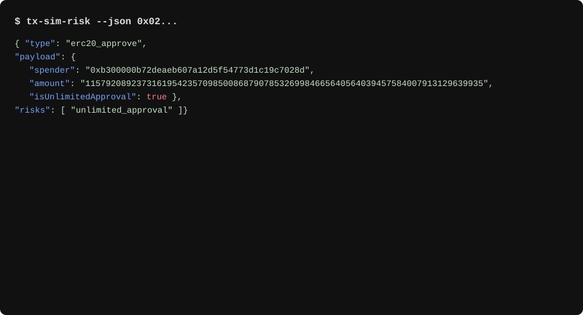

### tx-sim-risk — Zero-RPC EVM raw-tx unwrap + ERC-20 risk checks

Fast, dependency-light TypeScript library and CLI that:
- Unwraps raw Ethereum transactions (EIP-1559 and legacy) to extract calldata and chainId
- Decodes ERC-20 approvals/transfers, allowance updates
- Flags risky patterns like unlimited approvals and burns to the zero address

Educational note: This project is for educational purposes only. It does not constitute financial advice. Always verify results independently before acting on them.


### 30-second quickstart

- Node.js 18+ and npm required
- Run via npx (after publish):
  - `npx tx-sim-risk --json 0x095ea7b3...`
- Or from source:
  - `npm ci && npm run build`
  - `node dist/cli.js --json 0x095ea7b3...`

CLI screenshot:



### Compare: manual inspection vs tx-sim-risk

| Task | Manual (explorer + mental parsing) | tx-sim-risk |
| --- | --- | --- |
| Detect unlimited ERC-20 approval | Inspect calldata, check amount = 2^256-1 | Output includes `isUnlimitedApproval: true` and `risks: ["unlimited_approval"]` |
| Identify ERC-20 burn | Recognize transfer to 0x000…000 | Output includes `isToZeroAddress: true` and `risks: ["burn_to_zero_address"]` |
| Unwrap raw tx data | Decode RLP (typed-2 or legacy) | `extractDataAndChainIdFromRawTx` returns `{ data, chainId }` |

### Architecture (high-level)


### Real-world examples (mainnet)

- USDT unlimited approval (type-2 raw tx): `examples/rawtx-usdt-approve-unlimited.txt`
- USDT approval revoke (legacy raw tx): `examples/rawtx-usdt-approve-zero.txt`
- Uniswap V2 swap (legacy raw tx): `examples/rawtx-uniswap-swap-v2.txt`

You can pipe any of the above into the CLI:

```bash
node dist/cli.js --json "$(cat examples/rawtx-usdt-approve-unlimited.txt)"
```

### Development

- Lint: `npm run lint` (ESLint + Prettier)
- Typecheck: `npm run typecheck`
- Test: `npm test`
- Coverage: `npm run test:coverage` (V8, lcov + html)

### License

MIT © HM Sibghat Ullah

